<div align="center">


# Jarvis

**Um assistente pessoal com IA que mora no topo da sua tela do Windows.**

Fale ou digite: ele toca a música exata no Spotify, cuida da sua agenda, lê e responde e-mails quando você pede,
acha arquivos, anota no Obsidian, mostra clima, uso do PC e FPS dos jogos — tudo num notch discreto.


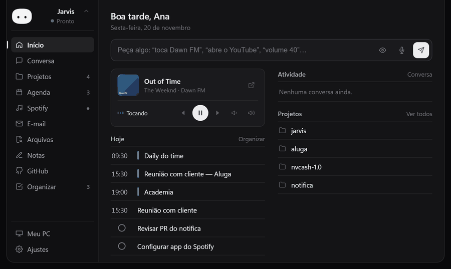

</div>

---

## Sumário

- [O que ele faz](#o-que-ele-faz)
- [Instalação](#instalação)
- [Primeira configuração (passo a passo)](#primeira-configuração-passo-a-passo)
  - [1. Conectar uma IA](#1-conectar-uma-ia)
  - [2. Voz: microfone e cadastro da sua voz](#2-voz-microfone-e-cadastro-da-sua-voz)
  - [3. Seu nome e suas pastas](#3-seu-nome-e-suas-pastas)
  - [4. Google Agenda e Gmail](#4-google-agenda-e-gmail)
  - [5. Spotify](#5-spotify)
  - [6. GitHub](#6-github)
  - [7. O notch: clima, uso do PC, FPS e mais](#7-o-notch-clima-uso-do-pc-fps-e-mais)
  - [8. WhatsApp](#8-whatsapp)
  - [9. OpenBot (opcional)](#9-openbot-opcional)
- [Usando no dia a dia](#usando-no-dia-a-dia)
- [Privacidade e segurança](#privacidade-e-segurança)
- [Solução de problemas](#solução-de-problemas)
- [Para desenvolvedores](#para-desenvolvedores)
- [Créditos e licença](#créditos-e-licença)

---

## O que ele faz

### O notch

Uma pílula no topo da tela, com o mascote, a música tocando e as informações que você escolher.

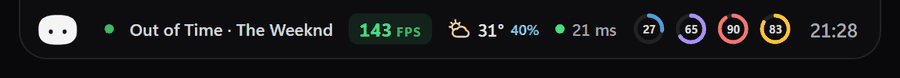

| | |
|---|---|
|  | **Clima** da sua cidade (sol, nuvem, chuva e chance de chuva), **ping** da internet e **círculos de uso** de CPU, RAM, placa de vídeo e disco. Passe o mouse num círculo para ver o componente (ex.: *AMD Radeon RX 6650 XT — 78%*). |
|  | Quando a internet cai, o aviso fica **vermelho**. |
| 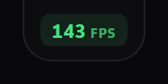 | **Medidor de FPS** em jogos e, no **modo jogo**, o notch mostra só o FPS e o Jarvis fica em silêncio. No fim, um resumo: tempo, FPS médio e 1% low. |
|  | Mostra o que toca em **qualquer app** (YouTube, VLC, Netflix…), não só no Spotify. |
|  | **Lembretes** da agenda aparecem com som e voz na hora certa. |

O notch pode ficar **sempre visível** ou **escondido** (aparece ao passar o mouse no meio da borda de cima ou quando você fala com o Jarvis), no monitor principal, num monitor específico ou **nos dois** (segue o mouse).

### O painel

Clique no notch para abrir o painel.

| Início | Agenda |
|---|---|
| 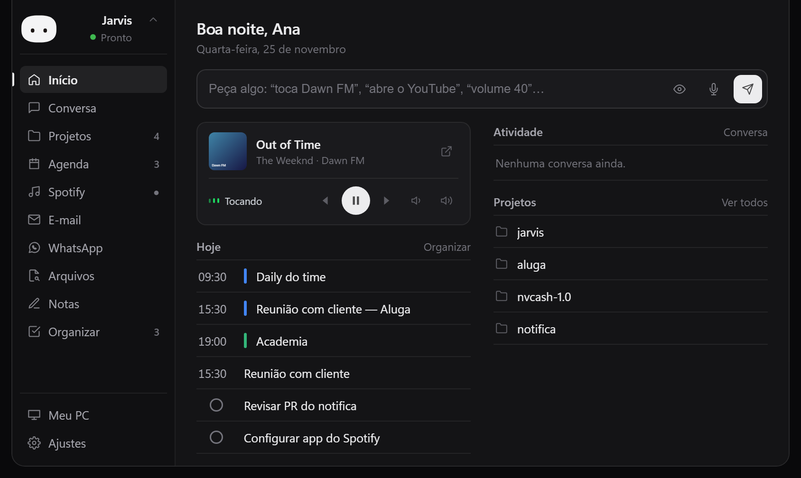 | 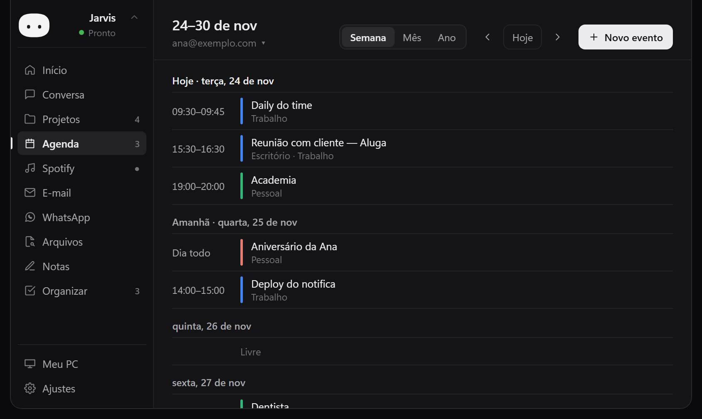 |
| Resumo do dia, música, compromissos e projetos. | Google Agenda completo: **Semana, Mês e Ano**, criar, mover e apagar eventos, com notificação. |

| Spotify | E-mail |
|---|---|
| 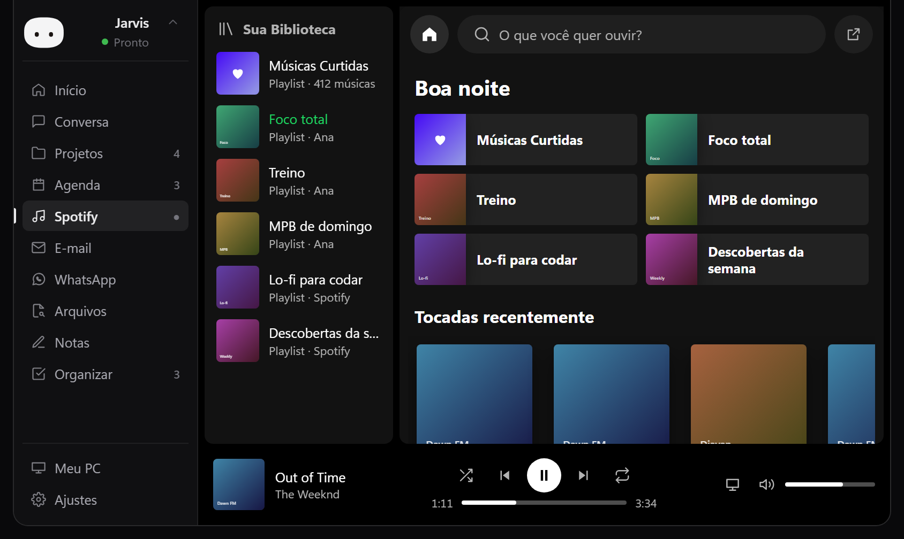 | 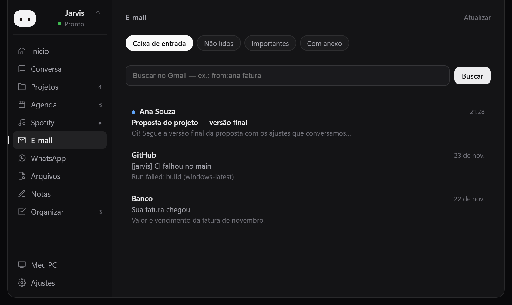 |
| Player com capa, playlists, curtidas, recentes e busca — com cara de Spotify. | Gmail **só quando você abre ou pede**: caixa de entrada, não lidos, busca, resumo e rascunho de resposta. |

| WhatsApp | Conversa no WhatsApp |
|---|---|
| 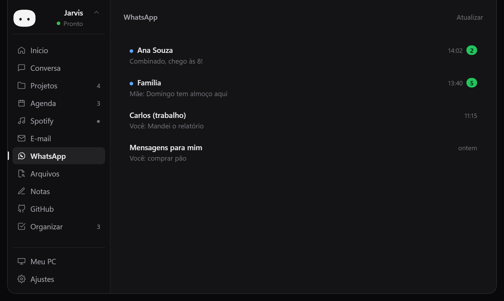 | 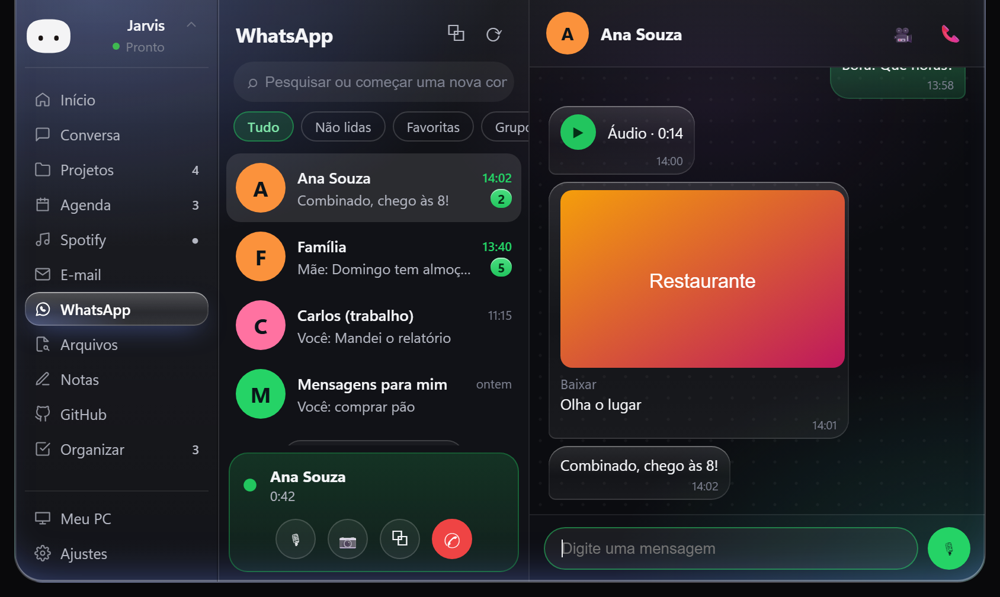 |
| Suas conversas **dentro do Jarvis**, com as não lidas em destaque — sem abrir navegador. | Leia e responda ali mesmo. Por voz, ele confirma a pessoa e o texto antes de enviar. |

| Arquivos | Notas (Obsidian) |
|---|---|
| 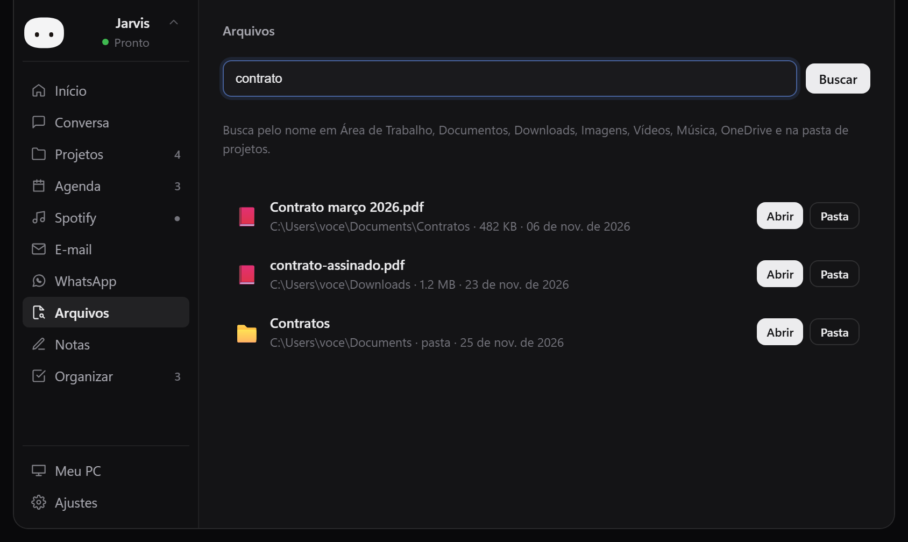 | 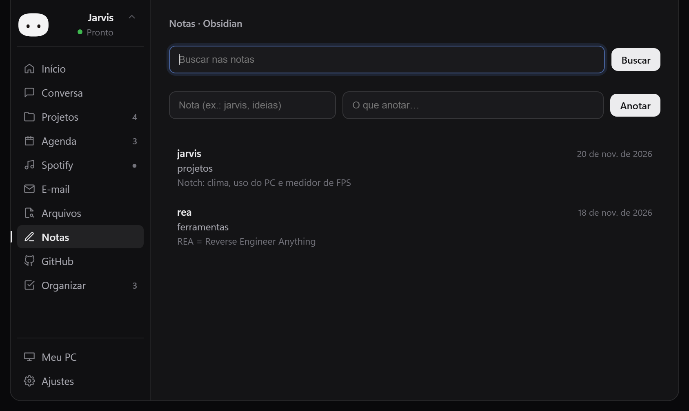 |
| Busca instantânea por nome nas suas pastas; abrir ou mostrar na pasta. | Busca, leitura e **anotação rápida** no seu vault. |

| GitHub | Meu PC |
|---|---|
| 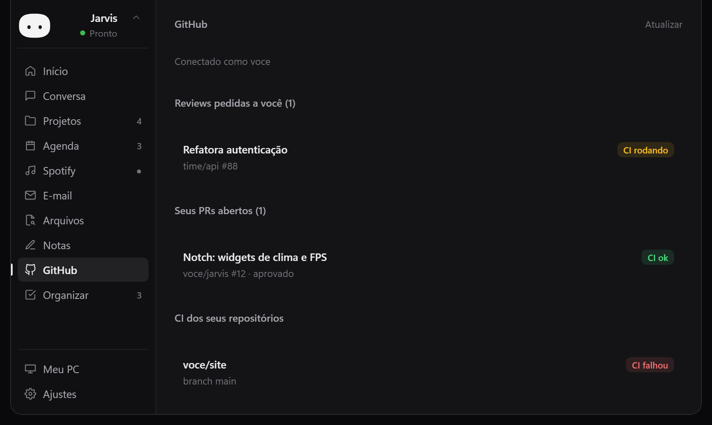 | 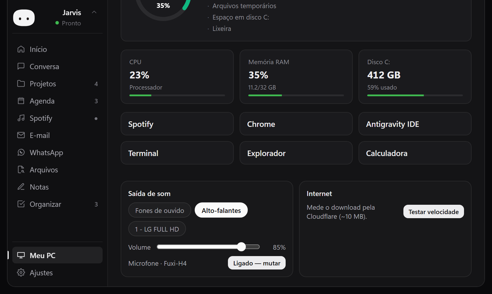 |
| Reviews pedidas a você, seus PRs abertos e CI que falhou. | Saída de som (fone/caixa/monitor), volume, microfone, teste de velocidade e mais. |

| Rotinas | IA com troca automática |
|---|---|
| 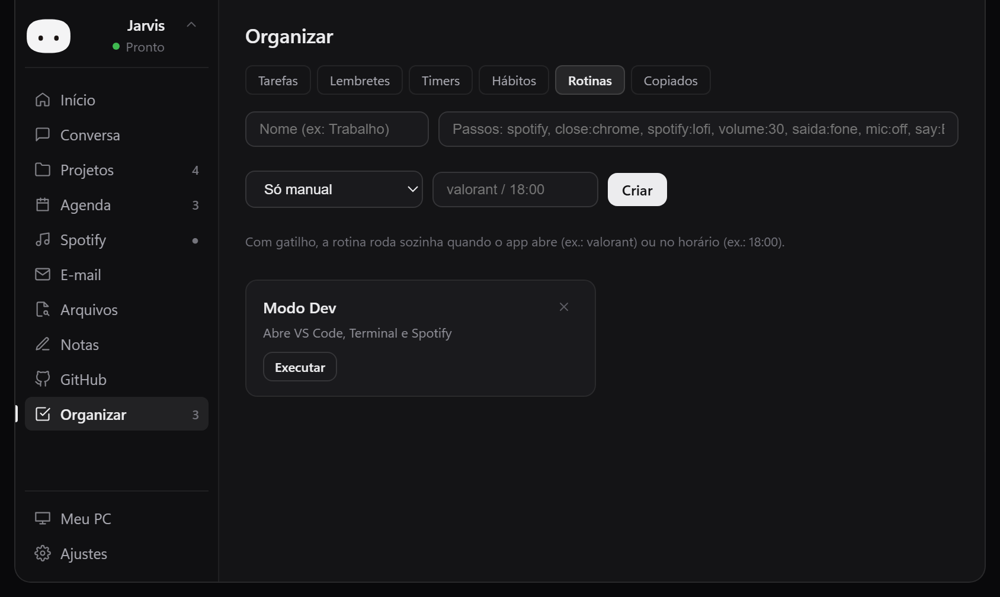 | 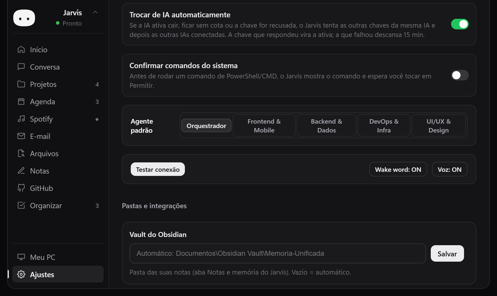 |
| Rotinas que rodam **sozinhas** quando um app abre (ex.: Valorant) ou num horário. | Gemini, Groq, OpenAI, Claude ou Ollama. Se uma cair ou ficar sem cota, ele **troca sozinho** para outra chave ou outra IA. |

### A IA

- **Conversa natural em português**, por voz (palavra de ativação “Jarvis”) ou texto.
- **Cadastro da sua voz**: o “Jarvis” é reconhecido no próprio PC — na hora, sem internet e mesmo com barulho em volta.
- **Conversa de verdade**: quando ele te faz uma pergunta, já fica ouvindo a resposta — não precisa dizer “Jarvis” de novo. E as respostas são faladas sem ler símbolos (nada de “asterisco”).
- **WhatsApp dentro do notch**: veja as conversas, leia e responda sem abrir nada; por voz ele manda, lê e diz o que chegou — só quando você pede.
- **Executa de verdade**: toca a música exata, abre sites e clica neles num navegador próprio, controla volume e mídia, cria eventos, procura arquivos, anota no Obsidian…
- **Atalhos instantâneos** para pedidos simples (“pausa”, “volume 30”, “bom dia”, “muda pro fone”) — respondem na hora, sem esperar a IA.
- **“O que tem na minha tela?”** — ela olha a tela e explica (Ctrl+Alt+J).
- **Tradutor** de qualquer texto selecionado (Ctrl+Alt+K).
- **Confirmação** antes de qualquer coisa que sai do PC (enviar e-mail, WhatsApp) e, se você quiser, antes de comandos do sistema.

---

## Instalação

**Requisitos:** Windows 10 ou 11 (64 bits). O WebView2 já vem no Windows.

### Opção A — instalador

1. Rode o instalador `Jarvis_x.y.z_x64-setup.exe` (da página de Releases do repositório, ou gerado em [Para desenvolvedores](#gerar-o-instalador)).
2. **O Windows vai avisar na primeira vez — é esperado.** O instalador não é assinado com certificado pago:
   1. Na tela **“O Windows protegeu o computador”**, clique em **Mais informações**.
   2. Clique em **Executar assim mesmo**.
3. O instalador pede **permissão de administrador uma única vez** (UAC). Ela é usada para executar ações no Windows e para medir o FPS dos jogos.
4. Pronto: daqui em diante o Jarvis **abre sozinho quando o Windows liga**, já com permissão de administrador e **sem perguntar de novo**. Para desligar, use Ajustes → IA & Voz → **Iniciar com o Windows**.

> **Como funciona o “uma única vez”:** na instalação, o Jarvis registra no Agendador de Tarefas do Windows a tarefa `\Jarvis\Launch` (“executar com privilégios mais altos”). Toda vez que ele abre — pelo menu Iniciar ou com o Windows — é por ela, então o UAC não aparece. A desinstalação remove a tarefa e a entrada de inicialização.

**Atualizações:** quando sair uma versão nova, o Jarvis avisa no notch e mostra o cartão **Nova versão** no topo de **Ajustes** — clique em **Baixar e instalar**. Ele baixa do GitHub do projeto, confere a assinatura digital e reinicia já atualizado. Também dá para conferir em Ajustes → IA & Voz → **Sobre → Verificar atualizações**.

O Jarvis não aparece na barra de tarefas: ele vive no **notch** no topo da tela e no **ícone da área de notificação** (perto do relógio), que tem *Abrir*, *Configurações* e *Sair*.

### Opção B — rodar a partir do código

Veja [Para desenvolvedores](#para-desenvolvedores).

---

## Primeira configuração (passo a passo)

Tudo se configura dentro do Jarvis: clique no notch → **Ajustes** (ou no ícone da área de notificação → *Configurações*). As chaves e senhas ficam no **Cofre de Credenciais do Windows** do seu usuário — cada pessoa usa as próprias.

> Tempo total: ~5 min para o básico (IA). Agenda/Gmail e Spotify levam ~10 min cada, uma única vez.

### 1. Conectar uma IA

Ajustes → **IA & Voz** → **Conexão com IAs** → **API Keys**. Basta uma; quanto mais, melhor (o Jarvis troca entre elas se uma falhar).

| IA | Onde pegar a chave | Observação |
|---|---|---|
| **Google Gemini** (recomendado) | [aistudio.google.com/apikey](https://aistudio.google.com/apikey) | Grátis, rápido e lê imagens (tela). Pode cadastrar várias chaves. |
| **Groq** | [console.groq.com/keys](https://console.groq.com/keys) | Grátis e muito rápido; também transcreve sua voz. |
| **OpenAI** | [platform.openai.com/api-keys](https://platform.openai.com/api-keys) | Pago por uso; lê imagens. |
| **Claude** | [console.anthropic.com](https://console.anthropic.com/settings/keys) | Pago por uso. |
| **Ollama** (local) | [ollama.com](https://ollama.com) | Roda no seu PC, sem internet. |

Depois:

1. Escolha o modo no topo — **Automático** (recomendado) usa a primeira IA conectada e passa para a próxima se ela falhar.
2. Deixe ligado **“Trocar de IA automaticamente”**.
3. Clique em **Testar conexão**. O status no topo da barra lateral deve ficar **“Pronto”** (verde).

### 2. Voz: microfone e cadastro da sua voz

O Jarvis atende por voz quando você diz **“Jarvis”**. Para ele ouvir bem — e rápido — faça estes dois ajustes em **Ajustes → IA & Voz**:

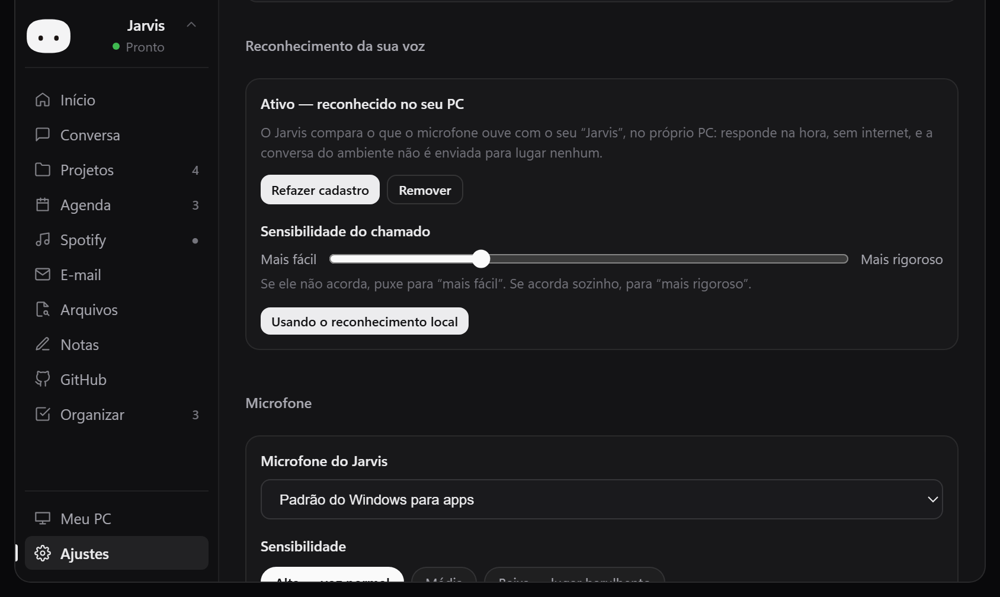

**2.1 — Escolha o microfone**

Em **Microfone → Microfone do Jarvis**, escolha **o microfone em que você fala**:

- **Padrão do Windows para apps** — o microfone padrão do Windows.
- **Fone/headset — dispositivo de comunicação do Windows** — normalmente o seu fone com microfone.
- Ou o aparelho pelo nome.

> Muitos PCs têm dois microfones (por exemplo, o da webcam e o do fone). Se o Jarvis estiver ouvindo o errado, você precisa gritar para ele entender.

**2.2 — Cadastre a sua voz (recomendado)**

1. Em **Reconhecimento da sua voz**, clique em **Cadastrar minha voz**.
2. Quando aparecer **“Diga ‘Jarvis’”**, fale **“Jarvis”** do jeito que você chama normalmente, à distância de sempre do microfone. São **6 vezes** — as bolinhas mostram o andamento. Se uma amostra sair curta, longa ou baixa, ele pede de novo.
3. Pronto: aparece **“Ativo — reconhecido no seu PC”**.

Com o cadastro, o “Jarvis” é reconhecido **no próprio PC** (com o [Rustpotter](https://crates.io/crates/rustpotter), um detector de palavra de ativação de código aberto):

- **Na hora** — sem esperar você fazer pausa, sem internet.
- **Funciona com barulho** — conversa e TV ao fundo não “parecem” o seu “Jarvis” e **não são enviadas para lugar nenhum**.
- **Sem gastar cota** — só o comando que você fala depois do “Jarvis” vai para a transcrição.

> Faça o cadastro **no lugar e com o microfone que você usa no dia a dia**. Mudou de microfone ou de sala? Clique em **Refazer cadastro**.

**2.3 — Ajuste fino**

| Ajuste | Quando mexer |
|---|---|
| **Sensibilidade do chamado** | Não acorda quando você chama → puxe para **Mais fácil**. Acorda sozinho → **Mais rigoroso**. |
| **Sensibilidade** do microfone (Alta / Média / Baixa) | Vale para o modo sem cadastro e para o Ctrl+Alt+V. **Alta** para voz normal; **Baixa** em lugar muito barulhento. |
| **Nível agora** | Barra ao vivo da sua voz (no modo sem cadastro): falando normal, ela deve ficar **verde e passar da linha**. |
| **Usando o reconhecimento local / nuvem** | Para comparar. Sem cadastro, o Jarvis usa a nuvem (transcreve as frases e procura “Jarvis” nelas). |
| **Palavras que o Jarvis deve conhecer** | Ele entende errado um nome, jogo ou app (ex.: “UFC 26” em vez de “FC 26”)? Escreva aqui, separado por vírgula. Apps comuns (Spotify, WhatsApp, Claude…) já estão incluídos. |

Pode falar no seu ritmo: uma pausa para respirar (até ~2 s) não encerra o pedido. E quando o Jarvis termina a resposta com uma pergunta, ele já abre a escuta — é só responder.

**Dica:** com o ambiente muito barulhento, use **Ctrl+Alt+V** — aperte, fale o comando (sem dizer “Jarvis”) e ele para sozinho quando você termina.

### 3. Seu nome e suas pastas

- **Nome**: Ajustes → **Mascote** → *Seu nome*. Vazio = o nome do seu usuário do Windows.
- **Pastas**: Ajustes → **IA & Voz** → **Pastas e integrações**:

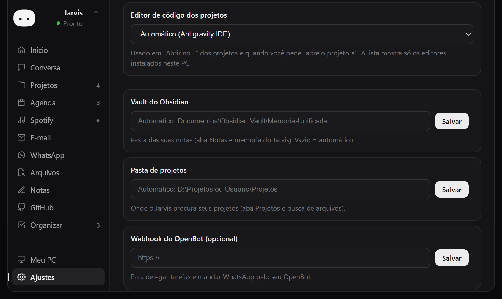

| Campo | Para que serve | Vazio = |
|---|---|---|
| Vault do Obsidian | Aba **Notas** e memória do Jarvis | `Documentos\Obsidian Vault\Memoria-Unificada` |
| Pasta de projetos | Aba **Projetos** e busca de arquivos | `D:\Projetos` se existir, senão `Usuário\Projetos` |

### 4. Google Agenda e Gmail

A Agenda e o Gmail usam **o mesmo login Google**. Como o Jarvis é um app pessoal, cada pessoa cria um “cliente” no Google Cloud **uma única vez** (é grátis):

**4.1 — Criar o projeto e ativar as APIs**

1. Abra [console.cloud.google.com](https://console.cloud.google.com) com a sua conta Google.
2. No topo, **Selecionar projeto → Novo projeto** → dê um nome (ex.: `jarvis`) → **Criar**.
3. Ative as duas APIs (botão **Ativar** em cada):
   - [Google Calendar API](https://console.cloud.google.com/apis/library/calendar-json.googleapis.com)
   - [Gmail API](https://console.cloud.google.com/apis/library/gmail.googleapis.com)

**4.2 — Tela de consentimento**

1. Vá em [**APIs e serviços → Tela de consentimento OAuth**](https://console.cloud.google.com/auth/overview) → **Começar**.
2. Nome do app: `Jarvis`; e-mail de suporte: o seu; público: **Externo**; contato: o seu e-mail → **Criar**.
3. Em **Público-alvo → Usuários de teste**, clique **Adicionar usuários** e coloque **o seu e-mail**.
4. *(Recomendado)* Em **Público-alvo**, clique **Publicar app**. Em modo “Teste” o Google desconecta você **a cada 7 dias**; publicado, não. O Google vai mostrar um aviso de *app não verificado* no login — é normal para apps pessoais: clique **Avançado → Acessar Jarvis**.

**4.3 — Criar o cliente**

1. Vá em [**Clientes → Criar cliente**](https://console.cloud.google.com/auth/clients).
2. Tipo de aplicativo: **App para computador** → nome `Jarvis` → **Criar**.
3. Copie o **ID do cliente** e a **Chave secreta do cliente**.

**4.4 — Conectar no Jarvis**

1. No Jarvis, abra a aba **Agenda**.
2. Cole o **Client ID** e o **Client secret** → **Usar este cliente**.
3. Clique **Conectar Google Agenda**, entre com a mesma conta e **marque todas as permissões** (Agenda e Gmail).

Pronto: a Agenda carrega e a aba **E-mail** funciona. Para trocar de conta ou liberar uma permissão depois, clique no **seu e-mail embaixo do título da Agenda → Reconectar conta / Desconectar**.

> **Gmail é só sob demanda.** O Jarvis nunca lê, conta ou comenta seus e-mails por conta própria — só quando você abre a aba E-mail ou pede (“tenho e-mail novo?”). E-mails **nunca são enviados** sem você tocar em **Permitir**.

**Lembretes que notificam:** peça “me lembra de pagar a conta amanhã às 9h” ou “me avisa 30 minutos antes da reunião”. O evento é criado com notificação (o Google avisa no celular) e o Jarvis avisa no PC com som e voz. No formulário *Novo evento* há o campo **Notificação**.

### 5. Spotify

Precisa de **Spotify Premium** (o Spotify só deixa outros apps controlarem a música no Premium).

1. Abra [developer.spotify.com/dashboard](https://developer.spotify.com/dashboard) com a sua conta Spotify → **Create app**.
2. Preencha:
   - **App name**: `Jarvis`; **App description**: `Assistente pessoal`
   - **Redirect URI**: `http://127.0.0.1:43821/callback` → clique **Add**
   - Marque **Web API** → aceite os termos → **Save**
3. Na página do app, copie o **Client ID**.
4. No Jarvis, abra a aba **Spotify**, cole o Client ID e clique **Conectar com Spotify**. Autorize no navegador.

Agora “toca Dawn FM do The Weeknd” toca **exatamente** isso.

### 6. GitHub

1. Crie um token em [github.com/settings/tokens](https://github.com/settings/tokens) → **Generate new token (classic)** com os escopos `repo` e `read:org`.
2. No Jarvis, aba **GitHub** → cole o token → **Conectar**.

### 7. O notch: clima, uso do PC, FPS e mais

Ajustes → **Notch**:

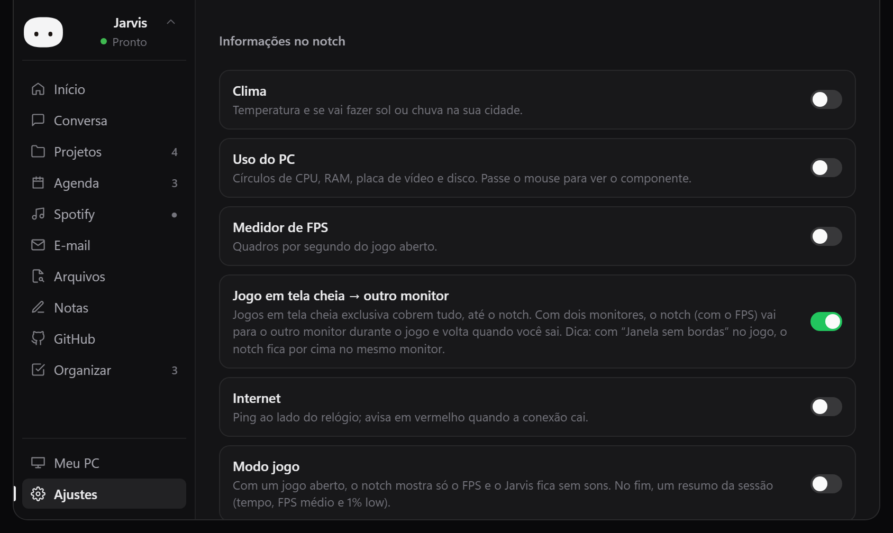

| Opção | O que faz |
|---|---|
| **Quando o notch aparece** | *Sempre visível* ou *Escondido* (aparece ao passar o mouse na borda de cima ou ao falar com o Jarvis). |
| **Em qual monitor** | Principal, um específico, ou *os dois* (vai para o monitor onde está o mouse). |
| **Clima** | Digite sua cidade e **Salvar** — ele mostra o que vai aparecer. |
| **Uso do PC** | Círculos de CPU, RAM, placa de vídeo e disco. |
| **Medidor de FPS** | FPS do jogo em primeiro plano. Precisa do Jarvis como **administrador**. Jogos DirectX (a maioria); Vulkan/OpenGL podem não aparecer. |
| **Jogo em tela cheia → outro monitor** | Jogos em *tela cheia exclusiva* cobrem qualquer janela. Com dois monitores, o notch (com o FPS) vai para o outro durante o jogo. Dica: com **“Janela sem bordas”** no jogo, o notch fica por cima no mesmo monitor. |
| **Internet** | Ping ao lado do relógio; vermelho quando cai. |
| **Modo jogo** | Com jogo aberto: só o FPS, sem sons; resumo da sessão no fim. |
| **Bom dia** | No primeiro início do dia, o Jarvis fala o clima, seus compromissos e tarefas. |

**Temperatura de CPU/GPU:** o Windows não tem um jeito próprio de ler esses sensores. Abra o [LibreHardwareMonitor](https://github.com/LibreHardwareMonitor/LibreHardwareMonitor) (deixe rodando) e a temperatura aparece ao passar o mouse nos círculos.

### 8. WhatsApp

O WhatsApp fica **dentro do Jarvis**, numa aba do notch — sem navegador por fora.


1. Abra o notch → aba **WhatsApp**. Aparece um QR code.
2. No celular: WhatsApp → **⋮ / Configurações → Aparelhos conectados → Conectar um aparelho** → aponte para o código.
3. Pronto: a aba mostra suas conversas (não lidas em destaque). Clique numa para ler e responder ali mesmo.

Por voz: “manda no WhatsApp pra mim: comprar pão”, “lê a conversa com a Ana”, “tenho mensagem nova no WhatsApp?”. O Jarvis **só lê quando você pede**. Antes de enviar, ele repete **a pessoa e o texto** e pergunta *“Posso enviar?”*: responda **“sim”** (envia na hora), **“não”** (cancela) ou peça uma correção. O que você mesmo digita na aba vai direto.

> A sessão fica só no seu PC (`%LOCALAPPDATA%\OpenJarvis\whatsapp-web`). Para desconectar, remova o aparelho em *Aparelhos conectados* no celular.

### 9. OpenBot (opcional)

Se você usa um OpenBot próprio, o Jarvis pode delegar tarefas de programação para ele (e, se o WhatsApp não estiver conectado no Jarvis, mandar mensagens por ele):

1. Ajustes → **IA & Voz** → **Pastas e integrações** → **Webhook do OpenBot**: a URL `https://` do seu webhook.
2. **Segredo do webhook**: o segredo HMAC (fica no cofre do Windows).

---

## Usando no dia a dia

### Falando com o Jarvis

Diga **“Jarvis”** e o pedido, clique no notch e digite, ou use **Ctrl+Alt+Espaço** para abrir a conversa.

| Diga… | O que acontece |
|---|---|
| “Bom dia, Jarvis” | Clima, compromissos e tarefas do dia (instantâneo) |
| “Toca Blinding Lights” / “toca outro álbum desse artista” | Spotify toca exatamente isso |
| “Pausa” / “próxima” | Funciona no app que estiver tocando (Spotify, YouTube…) |
| “Volume 30” / “muta o microfone” / “muda pro fone” | Instantâneo |
| “O que tenho amanhã?” / “marca dentista sexta às 10h e me avisa 1 hora antes” | Agenda com notificação |
| “Tenho e-mail novo?” / “resume o e-mail da Ana” / “responde dizendo que confirmo” | Gmail (rascunho; envio só com Permitir) |
| “Acha o PDF do contrato de março” | Busca nos seus arquivos e abre |
| “Abre o projeto aluga” | Abre a pasta do projeto no **Antigravity IDE** (ou no VS Code, se não tiver) |
| “Anota no projeto jarvis que preciso revisar o login” | Escreve no Obsidian |
| “Abre o YouTube e procura lo-fi” | Navegador do Jarvis abre, busca e clica |
| “O que tem na minha tela?” | Lê a tela e explica |
| “Minha internet tá lenta?” | Ping e teste de velocidade |
| “Manda no WhatsApp pra Ana que vou atrasar” / “manda pra mim: comprar pão” | Ele confirma a pessoa e o texto e pergunta se pode enviar |
| “Tenho mensagem nova no WhatsApp?” / “lê a conversa com a Ana” | Só quando você pede |

### Atalhos de teclado

| Atalho | Ação |
|---|---|
| **Ctrl+Alt+Espaço** | Abrir a conversa |
| **Ctrl+Alt+V** | Falar com o Jarvis agora (sem dizer “Jarvis”; para sozinho quando você termina) |
| **Ctrl+Alt+J** | “O que tem na minha tela?” |
| **Ctrl+Alt+K** | Traduzir/corrigir o texto selecionado (o resultado já vai para a área de transferência) |
| **Ctrl+Alt+S** | Silenciar/ativar os sons do Jarvis |
| **Esc** | Fechar o painel (ou clique fora dele) |

### Rotinas

Organizar → **Rotinas**. Cada rotina tem **passos** separados por vírgula e, se quiser, um **gatilho**:

- **Passos**: `spotify` (abre), `close:chrome` (fecha), `spotify:lofi focus` (toca), `volume:30`, `saida:fone`, `mic:off`, `say:Bom jogo!`, ou qualquer app/site/pasta.
- **Gatilho**: *Ao abrir um app* (ex.: `valorant`) ou *Num horário* (ex.: `18:00`).

Exemplo — **Modo jogo**: gatilho `app:valorant`, passos `close:chrome, saida:fone, volume:40, say:Bom jogo!`.

---

## Privacidade e segurança

- **Tudo é por usuário do Windows.** Chaves e tokens ficam no **Cofre de Credenciais do Windows**; configurações, contas de IA e dados ficam no seu perfil (`%APPDATA%` / `%LOCALAPPDATA%`). Outro usuário do PC não vê nada seu.
- **Nada é enviado para servidores do Jarvis** — não existem. Os pedidos vão direto para as IAs/serviços que **você** conectou.
- **Gmail e WhatsApp só sob demanda**. E-mail só sai com **Permitir**; WhatsApp, depois que você confirma por voz ou texto (“sim”).
- **Comandos do sistema**: em Ajustes → IA & Voz, ligue **Confirmar comandos do sistema** para aprovar cada comando de PowerShell/CMD antes de rodar.
- **Troca automática de IA** nunca repete um pedido que já fez algo (ex.: criar evento), para não duplicar.

---

## Solução de problemas

| Problema | Solução |
|---|---|
| “O Windows protegeu o computador” | **Mais informações → Executar assim mesmo** (instalador sem assinatura paga). |
| Status “Sem IA configurada” / “IA offline” | Ajustes → IA & Voz: conecte uma chave e clique **Testar conexão**. Clicar no status leva direto para lá. |
| Google: **Acesso bloqueado / access_denied** | Seu e-mail não está em **Usuários de teste** (passo 4.2) ou o cliente é de outro projeto. A aba Agenda mostra o número do projeto em uso. |
| Google: **redirect_uri_mismatch** | O cliente precisa ser do tipo **App para computador** (passo 4.3), não “Aplicativo da Web”. |
| Agenda desconecta toda semana | Publique o app (passo 4.2, item 4). |
| E-mail: “Gmail API não está ativada” | Ative a [Gmail API](https://console.cloud.google.com/apis/library/gmail.googleapis.com) no mesmo projeto. |
| E-mail: “sem permissão para o Gmail” | Agenda → clique no seu e-mail → **Reconectar conta** e marque o Gmail. |
| Spotify não toca a música certa | Conecte o Client ID (passo 5) e tenha Premium. |
| Precisa gritar / chamar várias vezes | Ajustes → IA & Voz → **Microfone**: escolha o microfone em que você fala; depois faça o **cadastro da sua voz** (passo 2). |
| Ouve “Jarvis” mas não o comando | Fale o comando logo depois do “Jarvis” (até ~6 s), em voz normal. Em lugar barulhento, use **Ctrl+Alt+V**. |
| Acorda sozinho | Sensibilidade do chamado → **Mais rigoroso**, ou **Refazer cadastro**. |
| “Limite de transcrição atingido” | As chaves gratuitas (Groq/Gemini) chegaram ao limite por minuto/dia. Com o cadastro de voz isso quase não acontece; cadastre mais chaves em Ajustes → IA & Voz. |
| FPS não aparece | Ligue *Medidor de FPS*, abra o Jarvis como administrador e deixe o jogo em primeiro plano. Em tela cheia exclusiva, ele aparece no **outro monitor**. |
| Entende palavras erradas (nomes, jogos) | Ajustes → IA & Voz → **Microfone** → *Palavras que o Jarvis deve conhecer*: escreva-as separadas por vírgula. |
| Corta o pedido quando você respira | Ele espera ~1,8 s de silêncio. Fale sem pausas longas no meio; para pedidos grandes, faça em duas partes. |
| WhatsApp: o QR code não aparece | Espere alguns segundos com a aba aberta (ele carrega o WhatsApp Web escondido). Se demorar, feche e abra o Jarvis. |
| WhatsApp pede o QR code de novo | Acontece ao reinstalar ou se o aparelho foi removido no celular. Escaneie de novo e apague os aparelhos antigos em *Aparelhos conectados*. |
| WhatsApp: “não achei o contato” | Diga o nome como está salvo no celular (ou o número com DDD). Ele mostra os nomes parecidos que encontrou. |
| Sem temperatura nos círculos | Abra o LibreHardwareMonitor. |
| Notch some em um jogo | Use *Janela sem bordas* no jogo, ou deixe ligado *Jogo em tela cheia → outro monitor*. |

O log fica em `%LOCALAPPDATA%\OpenJarvis\openjarvis.log` — as linhas `voice:` mostram o que o Jarvis ouviu, a nota de cada “Jarvis” e o que ele fez.

---

## Para desenvolvedores

### Requisitos

- [Rust](https://rustup.rs) (stable), [Node.js 20+](https://nodejs.org)
- **Visual Studio Build Tools** com *Desenvolvimento para desktop com C++*

### Rodar

```powershell
npm install
npm run tauri dev
```

### Publicar uma versão (com atualização automática)

1. Aumente `"version"` em `src-tauri/tauri.conf.json` (ex.: `0.1.5`) e escreva as notas em `docs/releases/v0.1.5.md`.
2. Rode:

   ```powershell
   npm run release
   ```

   Ele gera o instalador **assinado** e o `latest.json` em `target/release/bundle/nsis/`.
3. Crie a release **`v0.1.5`** no GitHub e anexe **o `.exe` e o `latest.json`**. As cópias instaladas do Jarvis encontram a nova versão em `releases/latest/download/latest.json` e oferecem a atualização.

A assinatura usa a chave privada em `~/.tauri/jarvis-updater.key` (ou `TAURI_SIGNING_PRIVATE_KEY`). **Ela nunca vai para o repositório — guarde um backup:** sem ela, as cópias instaladas não aceitam novas atualizações.

### Gerar o instalador

```powershell
npm run tauri build
```

O instalador fica em `target/release/bundle/nsis/Jarvis_x.y.z_x64-setup.exe` (português e inglês, instalação para todos os usuários do PC). Os ícones do app saem do logo em `docs/brand/jarvis-mark.svg`: `npm run icons`.

O executável sozinho fica em `target/release/openjarvis.exe`.

### Testes

```powershell
npm test                       # front-end (node:test)
npx tsc --noEmit -p .          # tipos
cargo test -p openjarvis       # Rust
```

> No Windows, o `build.rs` embute o manifesto *Common Controls v6* em todos os binários — sem ele os testes do Rust não abrem (erro `0xc0000139`).

### Prévia sem o app (no navegador)

Com `npx vite` rodando, abra `http://localhost:1420/dev/notch-preview.html` — o notch inteiro com dados fictícios. Parâmetros úteis:
`?open=agenda` (abre uma aba), `?open=whatsapp&wachat=Ana Souza` (uma conversa), `?widgets=1` / `?widgets=fps&game=1` (widgets), `?alert=1` (lembrete), `?net=off`.

As imagens deste README saem dela: `python scripts/readme_shots.py` (precisa de Chrome/Edge e `pip install pillow`).

### Arquitetura

```
src/                        front-end (TypeScript, sem framework)
  jarvis/notch_app.ts       notch + painel (abas, ajustes)
  jarvis/notch_widgets.ts   clima, círculos do PC, FPS, ping
  jarvis/tool_tabs.ts       abas E-mail, WhatsApp, Arquivos, Notas, GitHub, áudio
  jarvis/voice.ts           voz: escuta, comando, resposta falada (sem markdown)
  jarvis/agenda_panel.ts    Agenda (Semana/Mês/Ano)
  jarvis/music_panel.ts     Spotify
  mochi/                    o mascote (Canvas 2D), roupas e acabamentos
src-tauri/src/              back-end (Rust)
  jarvis_brain.rs           IA: rotas, troca automática, function calling
  jarvis_tools.rs           ferramentas novas (Gmail, bom dia, arquivos, notas…)
  jarvis_fastpath.rs        comandos instantâneos sem IA
  google_calendar.rs        Google Agenda (OAuth PKCE)
  gmail.rs                  Gmail (ler, rascunho, enviar com Permitir)
  spotify_api.rs            Spotify Web API (PKCE)
  jarvis_browser.rs         navegador controlado (Chrome DevTools Protocol)
  whatsapp.rs               WhatsApp Web oculto no próprio app (WebView2 + DevTools), aba e ferramentas
  pc_monitor.rs             CPU/RAM/GPU/disco, FPS via ETW, ping, temperaturas
  audio.rs                  saídas de som, microfone
  app_update.rs             atualizações pelo GitHub Releases (assinadas)
  wakeword.rs               cadastro de voz e “Jarvis” reconhecido no PC (cpal + Rustpotter)
  media_sessions.rs         mídia de qualquer app (SMTC)
  alerts.rs                 lembretes e notificações
  routines.rs               rotinas com gatilho
  file_search.rs, notes.rs  busca de arquivos, Obsidian
  island.rs                 janela do notch, monitores, clique
```

---

## Créditos e licença

O Jarvis é baseado no **[Coucou](https://github.com/Louis-CFM/coucou)** (OpenJarvis para Windows), de **Louis Raille**, sob a **Licença MIT** — o aviso de copyright original vale para o código herdado. A documentação original (ilha, Claude Code, pílulas, recap semanal, Linux) está em [`docs/README-original-coucou.md`](docs/README-original-coucou.md).

Código sob a licença **MIT**.
